  

# zmk-config-nickey44a

分割40%ワイヤレス自作キーボード **「Nickey44A」** のZMK Firmware設定リポジトリです。

## Nickey44Aについて

- 44キーのオーソリニア配列を採用した左右分割キーボード
- Bluetooth対応の完全ワイヤレス設計
- Choc v2スイッチ対応のロープロファイル設計
- 単4電池で動作
- ボトムからトッププレートまで6.5mmの薄型設計
- 電池、キースイッチキャップ込で222gの軽量仕上げ

BOOTHでは、キット版と完成品を取り扱っています。

- [Nickey44A キット版](https://potamega.booth.pm/items/8744351)
- [Nickey44A 完成品](https://potamega.booth.pm/items/8744204)

セットアップ、ファームウェアの書き込み、Bluetoothペアリングなどの詳しい手順は、[Nickey44A ビルドガイド](https://nixiy.github.io/nickey-docs/nickey44a/)を参照してください。

---

## 現在のキーマップ

図にないレイヤーが3つあります。どちらもキーは変えず、トラックパッドの動きだけを変えます。

- MOUSE_SLOW: 右パッドに触れてからSpaceを押している間。下の表の「Spaceを押しながら」。
- IPAD: 接続先にiPad（BT1）を選んでいる間。キーはMacと同じ。
- ANDROID: 接続先にAndroid（BT2）を選んでいる間。キーはWindowsと同じで、違うところだけを切り替えます。

### トラックパッドの操作

どの機器でも同じ動きにして、同じ操作をパッドの2か所に置かないようにしています。
送るキーはMac・iPadとWindows・Androidで違います（[一覧](docs/customizations.md#トラックパッド)）。

右パッド（空欄は普段と同じ）:

| 操作 | 普段 | Spaceを押しながら | LANG2を押しながら |
|---|---|---|---|
| 1本指で動かす | カーソル | ゆっくり動かす | |
| 1本指でタップ | 左クリック | | |
| 2本指でタップ | 右クリック | 標準の大きさに戻す | |
| 2本指で上下 | 縦スクロール | | |
| 2本指で左右 | 横スクロール | 戻る / 進む | アプリスイッチャー |
| ピンチ | 拡大 / 縮小 | | |

Spaceは、右パッドに触れてから0.8秒以内に押します。

左パッド:

| 操作 | 動き |
|---|---|
| 1本指で長押し | 左ボタンを押したまま（右パッドでカーソルを動かしてドラッグ） |
| 2本指でタップ | 中クリック |
| 2本指で上下 | タブ移動 |
| 2本指で左右 | 仮想デスクトップ（iPad・Androidでは何もしない） |

詳しくは[トラックパッドの設定](docs/dual-tps43.md)にあります。

このフォークで変えた点（tomkeyベースのキーマップ、トラックパッドのジェスチャ、ソフトオフなど）は、[カスタマイズのまとめ](docs/customizations.md)にあります。

---

## ⌨️ キーマップの変更方法 (Keymap Editor)

Web GUIツール **[Keymap Editor](https://nickcoutsos.github.io/keymap-editor/)** を使うと、コードを直接編集せずにブラウザ上でキーマップを変更できます。

1. 本リポジトリを自身のGitHubアカウントに Fork します。
2. [Keymap Editor](https://nickcoutsos.github.io/keymap-editor/)でForkしたリポジトリを選択し、キーマップを編集して保存します。
3. Commit / Push 後、GitHub Actions がファームウェアを自動ビルドします。

Forkの初回設定や詳しい編集手順は、[キーマップの変更方法](https://nixiy.github.io/nickey-docs/guides/keymap/)を参照してください。

> 💡 **コードを直接編集する場合:**  
> リポジトリ内の `config/nickey44a.keymap` を直接編集して Commit / Push することでも変更可能です。

---

## 🛠️ ファームウェアのビルドと書き込み方法 (Flashing)

Keymap Editorでの変更をCommit（または `main` ブランチへPush）すると、GitHub Actions がファームウェアを自動ビルドします。完了後、Actions の最新ワークフローから `firmware` をダウンロードしてください。

書き込みの詳しい手順は、[Firmwareの書き込み方法](https://nixiy.github.io/nickey-docs/guides/firmware/)を参照してください。左右のペアリングや設定リセットについては、[Nickey44A ビルドガイド](https://nixiy.github.io/nickey-docs/nickey44a/)を確認してください。

---

## 📄 ライセンス

This repository is licensed under the MIT License - see the [LICENSE](LICENSE) file for details.

### 第三者ライセンス

Nickey44A の昇圧回路は、cormoran 氏が [DYA Dash の回路設計解説](https://note.com/cormoran/n/n1e45fe7471d8) で紹介している、各種保護機能付き昇圧回路を参考にしています。DYA Dash の回路図（`*.kicad_sch`）は MIT License で提供されています。

- Copyright (c) 2025 cormoran
- ライセンス全文: [THIRD_PARTY_NOTICES.md](THIRD_PARTY_NOTICES.md)
